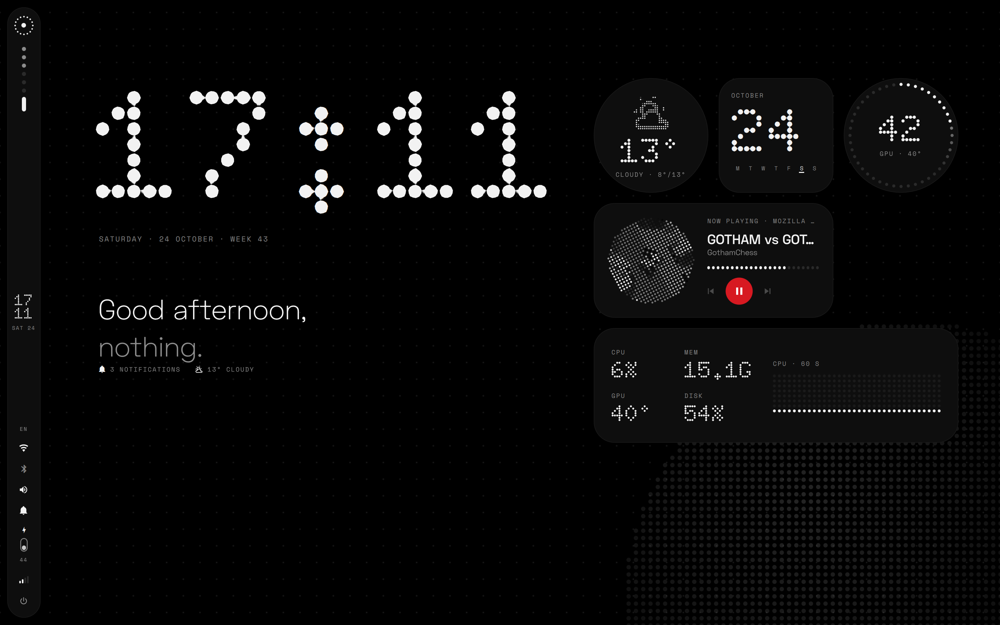

<div align="center">

# ● GLYPH UI STYLE

**Black, white dots, one red.**

面向 AI Coding Agent（Antigravity / Claude Code / Cursor / OpenClaw 等）的 **Nothing OS 工业点阵风格 UI 设计 Skill**。  
将极简 7 级黑白灰阶、LED 点阵矩阵、唯一活体红点（`#D71921`）与无过冲 Glide 动效，封装为可直接复用的跨平台 UI 设计规范与 Design Tokens。


<br />

**[▶ 在线体验交互式组件 Demo (Live Preview)](https://isdou.github.io/glyph-ui-style/demo.html)**

<br />



</div>

---

## ✨ 这是什么

`glyph-ui-style` 是一个面向现代前端与桌面应用开发的 **UI Design Skill**。当你想用 AI 构建具有硬件精密感、极高对比度与极简工业美学的界面（Dashboard、系统监控面板、音频/硬件控制台、极客效率工具、AI 产品控制台）时，只需加载本 Skill，AI 就会严格遵循这套视觉语言输出代码。

### 核心设计原则
- **7 级单色灰阶**：摒弃花哨渐变与廉价毛玻璃，依靠精确的 7 级黑白灰（`#000000 → #0E0E0E → #1A1A1A → #2A2A2A → #4A4A4A → #8C8C8C → #F2F2F2`）与 `1px` 细线建立空间层级，完整支持 Dark / Light 双模式自动反转。
- **「唯一红点」铁律（One Live Red）**：`#D71921` 在同一视野内**最多只出现 1 处**，专用于标识「当前正在运行的活体焦点」或紧急告警；其余所有选中态与激活态严格采用黑白反色。
- **三字体分工体系**：
  - `Doto`（圆点点阵体，字号 `>= 26px`）：时钟、KPI 巨型数字与短词
  - `Space Grotesk`：界面正文与大号欢迎语
  - `Space Mono`（全大写 + `0.14em` 字距）：元标签、状态栏与硬件标识
- **Glide 机械阻尼动效**：统一使用 `cubic-bezier(0.25, 1, 0.5, 1)`（`ease-out-quart`，`350ms`），快启慢收、**零过冲回弹**。

---

## 🎮 Interactive Demo（交互式组件演示）

> **在线预览**：https://isdou.github.io/glyph-ui-style/demo.html

本仓库内置了一个 **零依赖、可离线运行** 的完整交互演示页 [`demo.html`](./demo.html)，直接加载仓库内嵌的 `Doto`、`Space Grotesk`、`Space Mono` 开源字体，集中展示了 6 大标志性 Glyph 组件：

| 组件 | 交互体验 |
|---|---|
| **Dark / Light 主题切换** | 顶栏胶囊一键切换 7 级灰阶与点阵画布背景 |
| **Doto 点阵时钟卡** | 圆点点阵实时时钟 + `steps(1)` 机械离散闪烁冒号 |
| **44-LED 环形点阵进度（Ring）** | 点击 `25 / 76 / 100` 胶囊，体验每颗 `8ms` 顺时针波浪点亮动画 |
| **12 段交互式分段灯带（Seg）** | 点击任意段落实时调节 `VOLUME` / `BRIGHTNESS` 并联动数字读数 |
| **媒体播放器（唯一红点）** | 全屏唯一 `#D71921` 圆形播放键 + 16×6 动态点阵频谱可视化与切歌 |
| **展开式胶囊开关（Expanding Toggle）** | 点击体验 `350ms` Glide 无过冲展开与文字反色平滑位移 |

### 本地体验 Demo
```bash
git clone https://github.com/isdou/glyph-ui-style.git
cd glyph-ui-style
open demo.html   # macOS（Linux 可用 xdg-open demo.html，Windows 直接双击打开）
```

---

## 📦 安装与使用

### Antigravity（推荐）
将仓库克隆到本地，并软链接到全局 skills 目录：
```bash
git clone https://github.com/isdou/glyph-ui-style.git ~/glyph-ui-style
ln -sfn ~/glyph-ui-style ~/.gemini/config/skills/glyph-ui-style
```

### Claude Code / Cursor / OpenClaw 等其他 Agent 平台
将本仓库目录放入对应平台的 `skills/` 目录（确保 `SKILL.md` 位于 `skills/glyph-ui-style/SKILL.md`），或在提示词中直接引用 [`SKILL.md`](./SKILL.md) 与 [`references/tokens.css`](./references/tokens.css)。

### 触发方式
安装后新开对话，直接向 AI 描述需求即可自动触发，例如：
- 「用 **Glyph 风格**帮我做一个 AI 模型监控 Dashboard」
- 「按 **Nothing OS 点阵风**写一个番茄钟组件，支持深浅色切换」
- 「套用 **glyph-ui-style** 重构这个设置面板」

---

## 📁 仓库结构

```text
glyph-ui-style/
├── SKILL.md                  # Agent Skill 核心规范（设计哲学、Token、组件原语、反模式红线）
├── demo.html                 # 零依赖交互式组件 Demo（双击浏览器打开）
├── references/
│   └── tokens.css            # 可直接复用的 Dark/Light CSS Design Tokens 与基础组件样式
└── assets/
    ├── fonts/                # 内嵌 OFL 开源字体（Doto / Space Grotesk / Space Mono）
    └── screenshots/          # 原版 Glyph 桌面视觉参考图
```

---

## 🙏 致敬与鸣谢 (Credits & Attribution)

本 Skill 的视觉设计体系、色彩阶梯、点阵组件原语、动效曲线及参考素材，均提炼与致敬自优秀的开源 Linux 桌面美化项目：

- **原项目 & 原作者**：[**Nebelung-cloud/glyph-rice**](https://github.com/Nebelung-cloud/glyph-rice) by [@Nebelung-cloud](https://github.com/Nebelung-cloud) — *A Nothing OS rice for Hyprland + Quickshell*。原项目在 Arch Linux / Hyprland / Quickshell 上打造了极具完成度的点阵美学桌面，本仓库旨在将这份惊艳的视觉语言抽象为跨平台的 AI UI Skill，让 macOS / Windows / Web 开发者也能在前端与桌面界面中延续它的美学。
- **上游灵感与字体致谢**：
  - [**Nothing OS**](https://nothing.tech) — 原始工业美学与 Glyph 灯光交互灵感（Nothing / Nothing OS / Glyph 为 Nothing Technology Ltd. 商标，本项目为非官方粉丝衍生项目）
  - [**Doto**](https://github.com/oliverlalan/Doto) by Oliver Lalan — 点阵可变字体（OFL-1.1）
  - **Space Grotesk & Space Mono** — 正文与等宽标签字体（OFL-1.1）

## 📄 License

- 衍生自 [`Nebelung-cloud/glyph-rice`](https://github.com/Nebelung-cloud/glyph-rice) 的设计参考图与规范延续 **GPL-3.0** 协议。
- `assets/fonts/` 下的字体文件遵循各自开源协议 [**OFL-1.1**](./assets/fonts/OFL.txt)。
